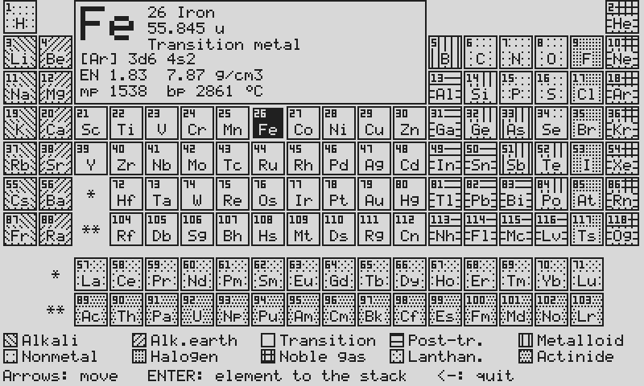

<!-- SPDX-License-Identifier: MIT -->
<!-- Copyright © 2026 SwissMicros GmbH -->
# ptable: a periodic table, and molar masses

Three commands for chemistry on the calculator:

| Command | Stack | What it does |
| --- | --- | --- |
| `PTABLE` | `→ list` or `→` | The periodic table on the whole screen. Move with the arrows. ENTER gives the selected element's list; ← gives nothing. |
| `ELEM` | `z → list`, `"Fe" → list`, `"iron" → list` | An element's data, by atomic number (1 to 118), symbol (exact case) or name (any case). |
| `MOLMASS` | `"Ca(OH)2" → 74.092` | The molar mass of a formula in g/mol. |



## PTABLE

All 118 elements in the usual 18 columns, with the lanthanides and actinides in two rows below. Each cell shows the
atomic number and the symbol. Its background pattern gives the category, and the legend at the bottom names each
pattern. The empty corner above the transition metals holds the selected element's details:

```
Fe   26 Iron
     55.845 u
     Transition metal
[Ar] 3d6 4s2
EN 1.83  7.87 g/cm3
mp 1538  bp 2861 °C
```

That is the name, the atomic mass, the category, the electron configuration, the Pauling electronegativity, the
density, and the melting and boiling points. A mass in brackets, such as Tc's `[98]`, is the mass number of the most
stable isotope of an element that has no standard atomic weight. Density is in g/cm³, except for the gases (H, He, N, O,
F, Ne, Cl, Ar, Kr, Xe, Rn), whose density is in g/L. For C and As, which sublime, the box shows `sublimes` and that
temperature. A `-` means the value is not known. From Fm (100) on, only predictions exist for the bulk properties,
and the table leaves them out.

| Key | What it does |
| --- | --- |
| ▲ ▼ ◀ ▶ | Move to the next element that way, skipping gaps. ▼ from Y goes to La, and ▲ from Ce goes to Rf. |
| ENTER | Leave, giving the selected element's list (as `ELEM` gives it). |
| ← (backspace, `KEY` 55) | Leave, giving nothing. |
| ON | Abandon: `PTABLE` returns -1 and pushes nothing, as `dx_poll` requires. |

`PTABLE` remembers the selected element, so the next `PTABLE` starts there (until the extension is loaded again).

## The element list

`ELEM`, and `PTABLE`'s ENTER, give a list of ten items, always in this order:

```
{ Z "Sym" "Name" mass "Category" EN density mp bp "Config" }
{ 26 "Fe" "Iron" 55.845 "Transition metal" 1.83 7.87 1538 2861 "[Ar] 3d6 4s2" }
```

The numbers are reals, exact as written in the table, and temperatures are in °C. A value that is not known is the
empty string `""` instead of a real, so a program can test it with `TYPE`. Tc's mass is `98`, without the brackets.
The kit has no call to make tagged objects, so the items are not tagged: use `GET` with the position.

## MOLMASS

`MOLMASS` reads a formula written as on paper:

- an element is a capital letter, with an optional small one: `Co` is cobalt, and `CO` is carbon and oxygen;
- a count follows an element or a group: `H2O`, `Ca(OH)2`, `K4[Fe(CN)6]` (1 to 9999, with no leading 0);
- groups are `( )` or `[ ]`, nested up to 8 deep;
- a hydrate is joined with `*` or `.`, with an optional count: `CuSO4*5H2O`. The calculator's character set has no
  middle dot.

The sum is made in integers in units of 0.00001 g/mol, and the result is exact in decimal: `"H2O" MOLMASS` gives
`18.015`, never `18.0149999`. A bad formula gives `Bad formula`, an unknown symbol `Unknown element: Xx`, and more
than 8 nested brackets `Formula too deep`. A formula is at most 256 characters long.

## It shows how to

- keep a large table `const`, so it stays in the code part of the extension: the 118 elements' texts are 16-bit
  offsets into one string pool, which needs no relocations;
- generate C data from a CSV at build time (`mkdata.py`, run by the Makefile);
- write an interactive screen: draw into one frame in `.bss`, show it with `dx_show` only when the selection changes,
  and read the arrows and ENTER with `dx_key`;
- draw text with a 5 × 7 font of the sample's own (and a 3 × 5 one for the numbers);
- parse a small grammar by recursive descent within the 2 KB stack, and give exact decimal results with
  `dx_make_real_text`;
- test the pure C on the host: `make test` runs `test_ptable.c` with stub `dx_*` functions and writes `ptable.pbm`,
  the screen as `PTABLE` first draws it.

## Build and load

```sh
make            # ptable.ext, with the web tester's WebAssembly build inside when the Emscripten SDK is installed
make test       # the host tests (cc), and ptable.pbm
```

- **On the calculator:** copy `ptable.ext` to `/DM48/EXT/` and choose it once in SETUP → Programs → Extensions….
- **In the web tester:** choose `ptable.ext` in SETUP → Programs → Extensions…. `ELEM` and `MOLMASS` work everywhere.
  `PTABLE`'s keys reach `dx_key` only when the page is cross-origin isolated (it has `SharedArrayBuffer`). Without
  it, `dx_key` always returns 0: the table shows, but you can't move, and only ON leaves it.

It takes about 28 KB of the calculator's extension memory: the frame's 12 KB, and 16 KB for the code and the table.

## Expected output

```
26 ELEM               →  { 26 "Fe" "Iron" 55.845 "Transition metal" 1.83 7.87 1538 2861 "[Ar] 3d6 4s2" }
"Tc" ELEM 4 GET       →  98
"Ca(OH)2" MOLMASS     →  74.092
"CuSO4*5H2O" MOLMASS  →  249.677
"H2Xx" MOLMASS        →  Unknown element: Xx
```

## The data

`elements.csv` is the source: one row per element, readable and easy to correct. It was made from the database of
the [mendeleev](https://github.com/lmmentel/mendeleev) Python package (MIT licence), version 1.3.0. Masses are
standard atomic weights, to at most 5 decimals. Temperatures were converted from kelvin to °C, and gas densities
from g/cm³ to g/L. The values are for the usual form of each element (white P, monoclinic S, grey Se, white Sn).
Lu and Lr are counted with the lanthanides and actinides, where this layout draws them.
